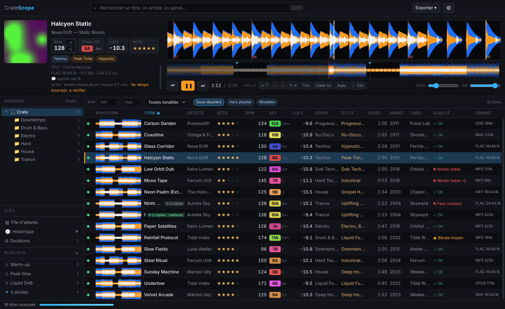
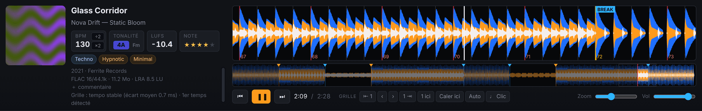
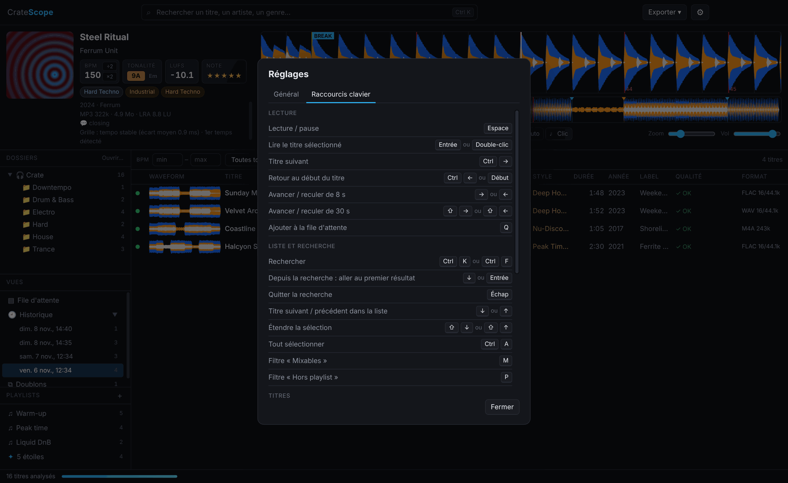
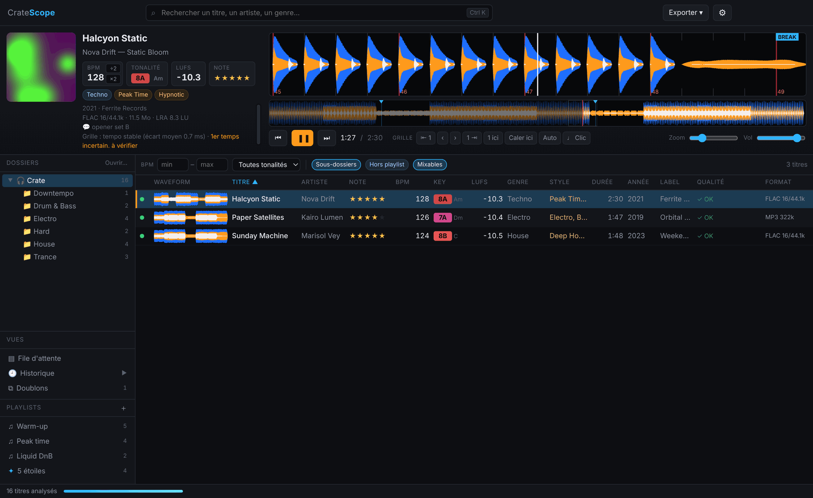
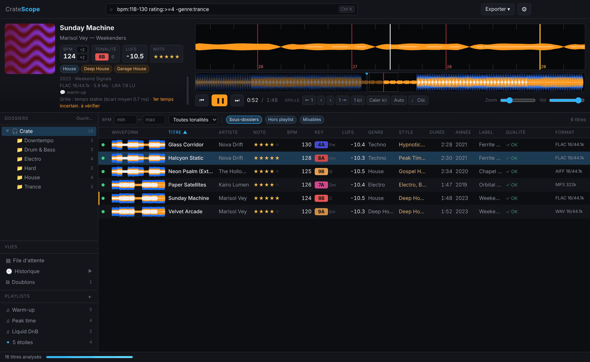
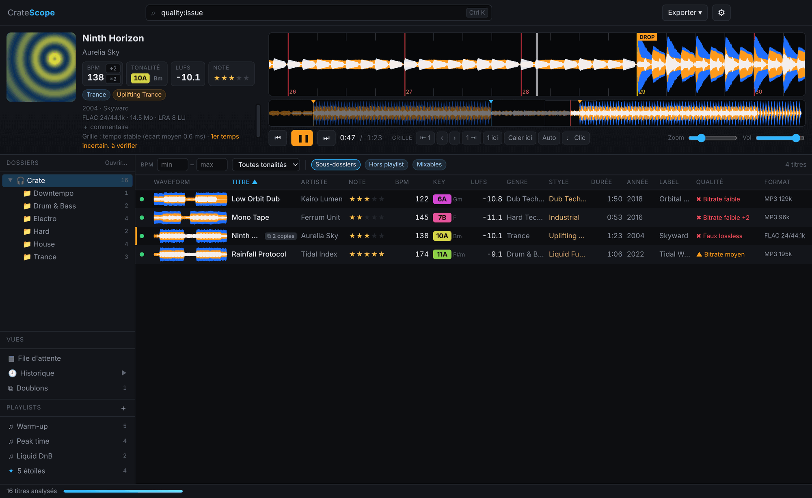
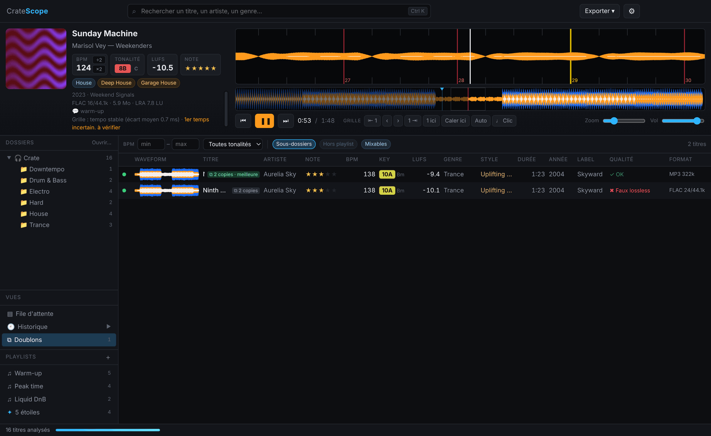
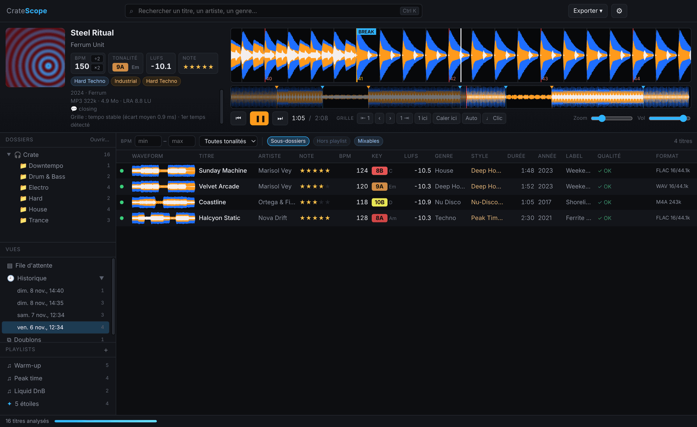
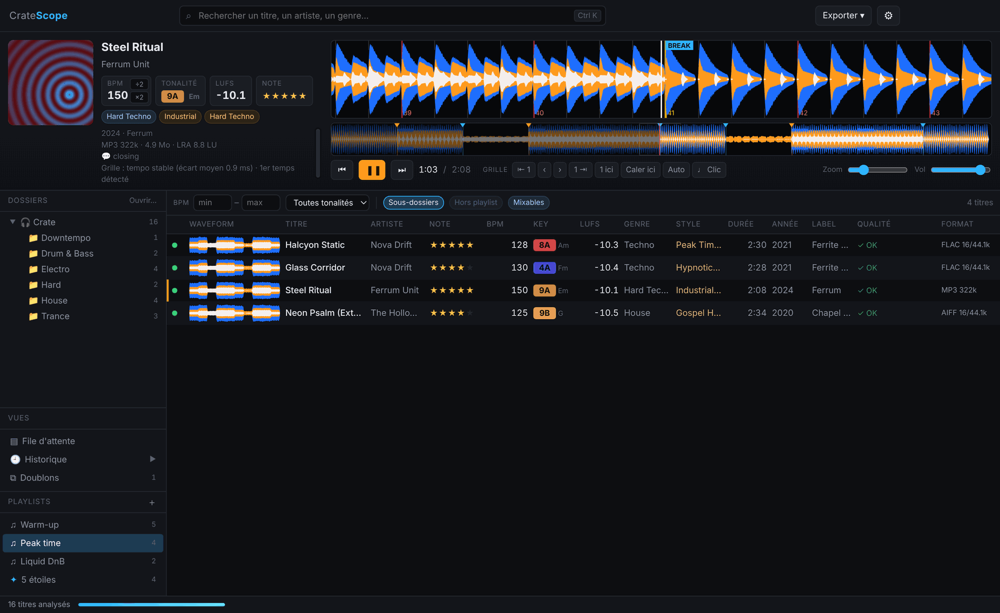

# CrateScope

Analyseur de bibliothèque musicale façon Rekordbox (Electron + ffmpeg) : BPM, tonalité (Camelot), waveform 3 bandes, loudness (LUFS), plus genre / style / label / année récupérés en ligne.



<sub>Captures faites sur une bibliothèque de démonstration (morceaux synthétiques, artistes et labels fictifs).</sub>

## Lancer

Prérequis : Node 18+ et `ffmpeg` / `ffprobe` dans le PATH (`brew install ffmpeg`).

```bash
npm install
npm start                      # rouvre le dernier dossier
npm start -- ~/Music/Crate     # ouvre directement un dossier
```

## Fonctionnement

- **Scan** récursif du dossier (mp3, wav, flac, aiff, ogg, opus, m4a, wma, ape…), surveillé en direct (ajouts/suppressions).
- **Analyse** en arrière-plan dans un pool de worker threads : un seul passage ffmpeg décode en mono 11 kHz *et* mesure le loudness EBU R128. Le DSP (JS pur, `src/analysis/dsp.js`) calcule :
  - BPM : enveloppe d'onsets multi-bandes → autocorrélation → vérification des niveaux métriques (×2, ×3/2, ×4/3…) par peigne aligné en phase → affinage au 1/100 de BPM + grille de temps ;
  - tonalité : chromagramme blanchi, accent sur la basse, profils de Sha'ath (libKeyFinder) → notation Camelot ;
  - waveforms (mini, vue d'ensemble, détaillée à 150 points/s) en 3 bandes.

  

  Le dossier en cours d'affichage est analysé en priorité. Résultats en cache (`~/Library/Application Support/cratescope`), donc les réouvertures sont instantanées.
- **Métadonnées en ligne** : MusicBrainz et Discogs, sans clé (Discogs donne genre **et** style, label, année). Facultatif dans ⚙︎ : un token personnel Discogs, ou la Consumer Key + Consumer Secret d'une application Discogs, ajoute les pochettes et accélère la recherche (60 titres/min au lieu de 25). Les titres déjà traités sont complétés automatiquement quand Discogs est activé ou qu'une clé est ajoutée.
- Plage de BPM réglable (88–180 par défaut) : les tempos sont ramenés dans cette plage. Avec une plage large (ex. 80–220), entre un tempo et son double c'est le plus proche de ~140 BPM qui l'emporte, sauf si l'autre est nettement plus marqué.

## Utilisation

- Clic = sélectionner (le titre en cours continue), double-clic / Entrée = lire. En fin de titre, le premier de la [file d'attente](#file-dattente) démarre, sinon le suivant de la liste.
- Tous les raccourcis : ⚙︎ › « Raccourcis clavier », ou touche `?`.

  

- `⌘→` titre suivant, `⌘←` retour au début (`Ctrl` sous Windows).
- Espace lecture/pause (lit le titre sélectionné si rien n'est chargé), ⏮ ou touche Début = retour au début du titre (garde lecture / pause), ↑/↓ déplacer la sélection, ←/→ avance de 8 s (Maj : 30 s), molette sur la waveform = zoom, glisser = scratch.
- **Mixables** (touche `m`) : n'affiche que les titres compatibles harmoniquement avec le titre chargé (Camelot ±1 / relatif) et à ±6 % de BPM (ou demi/double tempo).


- Glisser des lignes vers Rekordbox, Ableton, le Finder… ; clic droit : Finder, ré-analyse, re-recherche en ligne, Discogs/MusicBrainz.
- Export de la vue (ou de la sélection) en playlist M3U8, en CSV ou en **rekordbox XML**.
- **Colonnes** : clic droit sur l'en-tête pour afficher / masquer (Commentaire, Album, Écoutes, Chemin sont masquées par défaut). Clic sur un en-tête = tri, ⇧ clic = tri secondaire (ex. Genre puis BPM).

## Note, commentaire, infos

Rien n'est écrit dans les fichiers audio : tout reste dans CrateScope et part dans les exports (rekordbox XML, CSV, M3U8).

- **Note** : clic sur les étoiles (dans la liste ou le deck ; re-cliquer l'étoile active remet à 0), touches `0` à `5` sur la sélection, ou clic droit › Note. Exportée dans le champ Rating de rekordbox.
- **Commentaire** : « ＋ commentaire » dans le deck, ou clic droit › « Modifier le commentaire… ». Exporté dans les commentaires rekordbox, après la tonalité Camelot.
- **Titre / artiste / genre** : `F2` ou clic droit › « Modifier les infos… », aussi sur une sélection (un champ laissé vide n'est pas changé). Un genre corrigé remplace ceux des tags et en ligne. Les valeurs corrigées s'affichent en bleu ; « ↺ » ou clic droit › « Rétablir les infos du fichier » reviennent aux tags.

## Recherche

`⌘K` (`Ctrl+K` sous Windows) ou `⌘F` place le curseur dans la recherche ; ↓ ou Entrée descend sur le premier résultat, ↑ sur le premier titre remonte dans la recherche. Les filtres (BPM, tonalité, sous-dossiers, hors playlist, mixables) sont dans la barre au-dessus de la liste, avec le nombre de titres affichés.

Sans syntaxe, tous les mots doivent apparaître (titre, artiste, genres, styles, label, album, commentaire, nom de fichier, tonalité, BPM). Accents et majuscules ignorés. Avec syntaxe (infobulle du champ de recherche) :

| Syntaxe | Effet |
|---|---|
| `bpm:125-130`, `bpm:>140`, `bpm:128` | plage, borne, valeur (±0,5) |
| `key:8A`, `key:~8A`, `key:Am` | tonalité exacte / compatibles |
| `genre:`, `style:`, `label:`, `artist:`, `title:`, `album:`, `comment:` | filtre sur ce champ |
| `year:1995-1999`, `rating:>=4`, `lufs:>-8`, `kbps:<320`, `time:>6` (minutes) | valeurs numériques |
| `fmt:flac`, `fmt:lossless` | format |
| `quality:bad`, `quality:warn`, `quality:issue` | qualité du fichier |
| `dup:yes`, `played:yes`, `pl:no` | doublons, écoutés dans la session, dans aucune playlist |
| `-mot`, `-genre:trance`, `"deux mots"` | exclusion, expression exacte |



**Playlists intelligentes** : « ＋ » › « Playlist intelligente » enregistre une recherche (✦ dans la liste). Son contenu se met à jour tout seul, parmi les titres chargés (dossier ouvert et titres des playlists). Clic droit › « Modifier la recherche… ». Elle s'exporte comme une playlist.

## Qualité des fichiers

En arrière-plan, après l'analyse (un passage ffmpeg sur des extraits, ~0,2 s par titre), colonne « Qualité » (✖ problème, ▲ à vérifier, ✓ OK ; le détail est dans l'infobulle et dans le deck) :

- **Faux lossless** : un FLAC / WAV / AIFF dont le spectre s'arrête net à ~16, 19 ou 20 kHz a été fabriqué à partir d'un MP3 / AAC (128, 192 ou 320 kbps). Un MP3 « 320 kbps » coupé à 16 kHz a été ré-encodé depuis un 128.
- Bitrate faible (< 160 kbps) ou moyen (< 210 kbps), échantillonnage < 44,1 kHz.
- Mono enregistré en stéréo, écrêtage du mastering (simple info, mesuré sur les fichiers lossless uniquement : c'est un choix artistique, attendu en gabber ou en hardcore, pas un défaut du fichier).

Une coupure à ~20 kHz sur un lossless n'est qu'une suspicion ; au-dessus de 20,5 kHz c'est un filtre de mastering (inaudible, non signalé), un MP3 320 kbps s'arrêtant vers 20 kHz. Recherche : `quality:bad`, `quality:issue`.



## File d'attente

- Ajouter : touche `q` sur la sélection, clic droit › « Ajouter à la file d'attente » (ou « Lire ensuite » pour passer en tête), ou glisser des lignes sur Vues › **File d'attente**.
- La vue File d'attente se réordonne par glisser-déposer ; `⌫` / Suppr ou clic droit retire.
- En fin de titre (ou bouton ⏭), le premier titre de la file démarre et sort de la file. File vide : la lecture reprend dans la liste d'où elle était partie.
- « Ensuite : … » sous les infos du deck montre le prochain titre ; un clic ouvre la file. La file n'est pas gardée à la fermeture de l'app.

## Doublons

Vues › **Doublons** : les titres présents plusieurs fois (même artiste et titre, « original mix », « feat. », ponctuation et accents ignorés, et même durée à 2 s près), groupés, la meilleure version en premier et marquée ✓ (vrai lossless, puis bitrate, puis taille : un faux lossless passe derrière un bon MP3). Les remixes et edits ne sont pas des doublons. Rien n'est supprimé depuis l'app. Le badge ⧉ apparaît aussi dans la liste normale ; recherche `dup:yes`.



## Historique

Un titre écouté au moins 30 s (lecture réelle) s'affiche en vert pendant la session et entre dans l'historique (Vues › **Historique**, une entrée par lancement de l'app, dans l'ordre d'écoute). Clic droit sur une session : la convertir en playlist, l'exporter, la supprimer. Colonne « Écoutes » (masquée par défaut) : nombre d'écoutes au total. Clic droit sur un titre › « Marquer comme non écouté ».



## Playlists

Les playlists (en bas de la barre latérale) appartiennent à l'app, pas au dossier ouvert : elles peuvent mélanger des titres de plusieurs dossiers et restent disponibles quel que soit le dossier ouvert.

- « ＋ » crée une playlist ; double-clic pour la renommer, clic droit pour la renommer, l'exporter ou la supprimer.
- Ajouter des titres : glisser des lignes sur une playlist, clic droit › « Ajouter à une playlist », ou glisser des fichiers / dossiers depuis le disque (sur la playlist, ou dans la liste quand elle est affichée). Les titres hors du dossier ouvert sont analysés aussi.
- Retirer : `⌫` / Suppr sur la sélection, ou clic droit. Les fichiers ne sont jamais touchés.
- Ordre : celui d'ajout, modifiable en glissant les titres dans la liste (trait bleu = point d'insertion) ; cliquer sur une colonne trie la vue, re-cliquer sur la playlist revient à son ordre (c'est cet ordre qui est exporté).
- Export : clic droit sur une playlist (rekordbox XML ou M3U8), ou « Exporter » › « toutes les playlists » (un seul XML contenant toutes les playlists, ou un M3U8 par playlist).
- Un ⚠ indique des fichiers introuvables (déplacés ou supprimés).
- **Hors playlist** (touche `p`) : n'affiche que les titres du dossier qui ne sont encore dans aucune playlist, pratique pour trier une bibliothèque au fur et à mesure.



## Copier vers une clé USB

Clic droit sur une playlist › « Copier vers une clé USB… », ou « Exporter » › « Copier toutes les playlists vers une clé USB… », puis choisir un dossier sur la clé :

1. chaque playlist devient un dossier, les fichiers sont nommés `Artiste - Titre.ext` (noms compatibles FAT32 / exFAT) ; un titre présent dans plusieurs playlists n'est copié qu'une fois, un fichier déjà présent et identique n'est pas recopié ;
2. l'analyse est reprise telle quelle pour les copies (pas de ré-analyse si tu ouvres la clé dans CrateScope) ;
3. `CrateScope-rekordbox.xml` est écrit dans le dossier choisi, avec les playlists et des chemins vers les copies.

Il ne reste qu'à ouvrir ce XML dans rekordbox et à exporter les playlists vers la clé. L'espace libre est vérifié avant de commencer ; la copie s'annule depuis la barre d'état. Les titres pas encore analysés et les formats que rekordbox ne lit pas sont ignorés (liste dans l'infobulle du message final).

## Envoyer vers rekordbox

« Exporter » → « rekordbox XML » crée un fichier contenant, pour chaque titre : BPM et grille (avec la position du 1er temps de mesure), tonalité et genre / styles / label / année (aucun cue point). Tes corrections manuelles (BPM, calage) sont incluses. Les fichiers audio ne sont pas modifiés. Les formats que rekordbox ne lit pas (OGG, Opus, WMA…) sont ignorés.

Dans rekordbox :
1. Préférences → Avancé → Base de données → « rekordbox xml » : choisis le fichier exporté, et active l'affichage de « rekordbox xml » dans l'arborescence (Préférences → Vue → Mise en page).
2. Dans l'arborescence, ouvre « rekordbox xml » → « Playlists » → « CrateScope · <dossier> » (ou le nom de tes playlists), sélectionne les titres et fais clic droit → « Importer dans la collection » (ou importe la playlist entière).
3. Pour que rekordbox ne recalcule pas BPM et grille par-dessus, désactive l'analyse automatique du BPM avant l'import (Préférences → Analyse). Fais un essai sur quelques titres avant toute la collection.

Pour les MP3, la grille est décalée de l'écart de lecture entre ffmpeg et rekordbox (rekordbox lit la trame d'en-tête LAME/Xing comme du silence et ne retire pas le délai d'encodage : ~51 ms pour un MP3 LAME classique, calculé fichier par fichier).

La tonalité est exportée en notation classique (Am, F#m, Eb…) ; la notation Camelot est mise en tête des commentaires.
- **Grille** : le BPM est affiné par suivi des temps et régression sur tout le morceau (précision ~5 ms), le 1er temps des mesures est déduit des changements de section, les drops / breaks sont repérés (marqueurs DROP / BREAK, ligne jaune toutes les 16 mesures à partir du drop). Un avertissement s'affiche si le tempo varie (vinyle, live) ou si le 1er temps est incertain.
- **Corriger la grille** (barre « Grille » du deck) : `⇤ 1` / `1 ⇥` décalent le 1er temps de la mesure d'un temps (`[` `]`), `‹` `›` décalent la grille de 5 ms (Alt : 1 ms, touches `,` `.`), « 1 ici » fait du temps le plus proche de la tête de lecture un 1er temps (`G`), « Caler ici » cale la grille exactement sur la tête de lecture (`⇧G`), « Auto » revient à la détection. « ♩ Clic » (`C`) joue un métronome sur la grille pour vérifier à l'oreille.
- **BPM manuel** : clique sur le BPM du deck pour le saisir. La grille pivote autour du drop principal, là où elle compte le plus.
- BPM à moitié ou doublé ? Boutons **÷2 / ×2** à côté du BPM dans le deck, touches `/` et `*` (sur la sélection), ou clic droit. La correction est gardée même après une ré-analyse ; le BPM corrigé s'affiche en bleu.
- Un `*` à côté du BPM signale un désaccord avec le tag BPM du fichier.

## Apparence

⚙︎ › **Apparence** : couleur d'accent (8 couleurs ou n'importe quelle autre) et titre de la barre du haut, composé de plusieurs mots collés avec chacun sa couleur (gris, blanc, accent ou au choix), comme « Crate » + « Scope ». Aperçu en direct ; « Annuler » revient à l'apparence enregistrée.

## Mises à jour

L'app vérifie au lancement (puis toutes les 6 h) la dernière release GitHub. Si elle est plus récente, elle est téléchargée en arrière-plan, son empreinte SHA-256 est vérifiée avec celle publiée par GitHub, puis un bouton « Redémarrer pour passer à … » apparaît en bas à droite. Si tu quittes l'app sans cliquer, la mise à jour s'installe quand même à la fermeture.

- Réglages › Mises à jour : désactiver le mode automatique, ou « Rechercher une mise à jour ».
- L'app est remplacée à son emplacement actuel (`/Applications/CrateScope.app`, ou le dossier dézippé sous Windows). Si ce dossier n'est pas modifiable, un message l'indique et il faut installer la version à la main depuis la page de la release.
- Tes réglages, ta bibliothèque analysée et tes playlists ne sont pas touchés : ils sont rangés à part (`~/Library/Application Support/CrateScope`, `%APPDATA%\CrateScope`).
- Une mise à jour est proposée dès que la release a un numéro de version supérieur à celui de l'app installée.

## Mesurer la précision

`npm run eval -- <dossier>` compare l'analyse aux tags BPM/tonalité déjà présents dans les fichiers et mesure la stabilité de la grille. `node scripts/grid-test.js` vérifie BPM, grille, 1er temps et drop sur des morceaux synthétiques dont on connaît la vérité.

## Builds et releases

```bash
npm run package        # macOS Apple Silicon → dist/CrateScope-<version>-macos-arm64.zip
npm run package:mac-x64
npm run package:win    # Windows x64 (se construit aussi depuis macOS/Linux) → dist/CrateScope-<version>-windows-x64.zip
npm run install_app    # build Apple Silicon + copie dans /Applications
```

ffmpeg/ffprobe sont embarqués dans les builds (`scripts/fetch-ffmpeg.sh` → `vendor/`, copiés dans `resources/ffmpeg`). En dev, l'app utilise ffmpeg du PATH / Homebrew.

Chaque push sur `main` déclenche `.github/workflows/release.yml` : builds macOS (arm64 + x64) et Windows, vérification de ffmpeg et de l'analyse sur les binaires embarqués (`scripts/ci-check.js`, y compris sur un runner Windows), puis publication d'une release GitHub `v<version>` avec les trois zips, nommés `CrateScope-<version>-<système>-<arch>.zip`. Une seule release par version : un push sans changement de version dans `package.json` construit et teste, sans publier.

Les icônes sont générées depuis `build/icon.svg` (→ `icon.png` → `icon.icns`, et `node scripts/make-ico.js` pour `icon.ico`).
